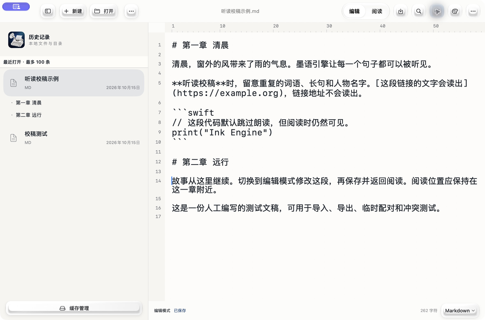
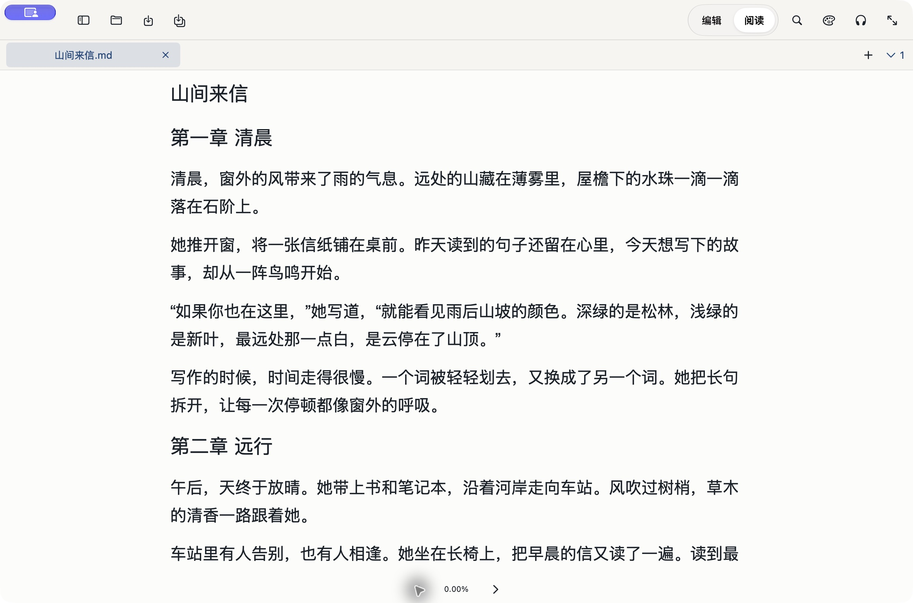
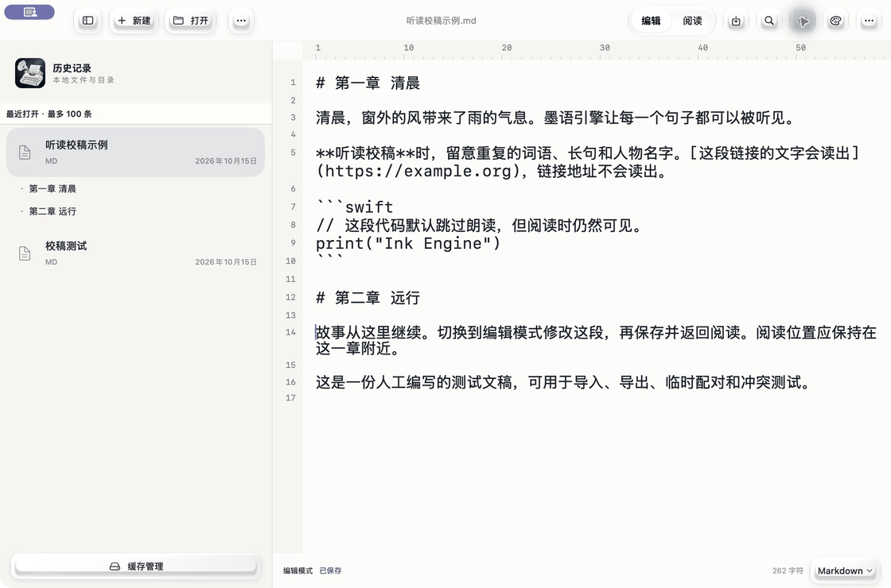

# 墨语引擎 · Ink Engine

Swift 原生小说编辑与离线听读应用，支持 Apple 芯片 Mac、iPhone 和 iPad。要求 macOS / iOS / iPadOS 26 或更新。

Mac 打开和编辑用户选择的原文件；手机和平板提供本机文稿及目录管理。支持文本编辑、Markdown 阅读、书签、阅读位置恢复、查找替换和附近设备手动同步。应用没有云端账户服务；附近设备同步需要用户主动操作与系统本地网络权限。

## 多文件工作区

Mac 与 iPad 支持多标签、左右分屏、克隆视图和多窗口。同一文稿共享正文与撤销记录，各视图保留独立的选区、滚动和阅读位置。

- 手动保存文稿，自动暂存恢复草稿；关闭未保存文稿时可保存、放弃或取消。iPhone 使用单文稿界面与自动保存。
- 标签支持固定、拖动、批量关闭、另存为、重命名、重载、只读、颜色标记和克隆。
- 切换标签时继续听读原文稿；在另一篇文稿播放时自动切换，播放标签显示扬声器图标。

## 能用它做什么

- **写作与修改**：Mac 直接打开本地原文件进行编辑，支持纯文本、Markdown，以及常见代码和数据文本。提供行号、列标尺、自动换行和语法高亮。
- **阅读文稿**：按目录或章节阅读，保存阅读位置；使用书签回到需要修改的段落。
- **听读校稿**：让文稿在本机读出来，检查重复、长句和不顺口的地方；支持暂停、继续、调速、上一段和下一段。
- **调整声音**：选择 ZipVoice 的 Serena 女声、Dylan 男声；添加人名、地名等自定义纠音词组。
- **在设备之间传文稿**：通过系统导入、分享，或主动发起附近设备手动同步。无需注册云端账户。

## 先看实际界面

以下为 **Mac 0.3.1 的真实界面**，使用仓库内人工编写的 [听读校稿示例](Samples/听读校稿示例.md)。iPhone 与 iPad 布局随屏幕调整。

**编辑：打开文稿后直接修改正文，顶部切换自动换行，底部选择语法。**



**阅读与听读：切换到阅读模式，下方可以开始、暂停、调速和跳段。**



### 操作 GIF：编辑 → 阅读 → 开始朗读 → 暂停



### 选择声音

打开文稿右上方“更多” →“字号与朗读设置”。先选 **ZipVoice**，再在“音色”中选择 **Serena** 或 **Dylan**。

## 第一次使用

**界面语言：** 在“更多”选项菜单的“语言”中切换“跟随系统 / 简体中文 / English / 繁體中文”；也可在“字号与朗读设置”→“语言”中选择，Mac 菜单栏另有“语言”菜单。切换立即生效，重启后保留，不改变文稿、阅读位置或所选朗读音色。

1. **打开文稿**：Mac 点击“打开”（⌘O）或“新建”（⌘N）；iPhone / iPad 从历史记录或本机文稿进入，使用导入入口加入文本。
2. **编辑与保存**：进入“编辑”，修改后点击保存；Mac 可按 ⌘S。Mac/iPad 自动暂存恢复稿，正式保存才写回文件；iPhone 保留自动保存。另存为用于选择新文件名和保存位置。
3. **开始听读**：切换到“阅读”，点击底部播放按钮。也可以点击正文中的一行，从该位置开始朗读；上下段按钮用于跳转。
4. **暂停和继续**：再次点击播放按钮暂停，之后从原位置继续。语速按钮和“字号与朗读设置”用于调整速度；各模型独立记住速度。
5. **换声音与纠音**：在“字号与朗读设置”选择模型和音色；“常用多音字与自定义词组”可加入读音不正确的人名、地名。
6. **保存需要回看的地方**：从文稿“更多”菜单进入“阅读书签”，添加或管理书签；章节入口可快速定位长文。
7. **换设备阅读**：从“同步数据到设备”或附近设备入口主动连接，并在目标设备确认接收；也可使用系统分享、导入。附近同步需要本地网络权限，文稿会传给你选择的设备。

**常用 Mac 快捷键：** ⌘O 打开、⌘N 新建、⌘S 保存、⌘⇧S 另存为、⌘F 查找、⌘⇧R 切换编辑 / 阅读。多文件工作区另有 ⌘W 关闭标签、⌘⇧W 关闭窗口、⌘⌥S 保存全部、Control-Tab / Control-Shift-Tab 切换标签。

## 获取应用

**Mac 安装包：** [下载 0.3.2 DMG 与 SHA-256 校验文件](https://github.com/ailifelab/InkEngine/releases/tag/v0.3.2)。支持 Apple 芯片 Mac、macOS 26 或更新，已内置离线声音。此包已使用 Developer ID 签名并通过 Apple 公证；具体安装方式见发行说明。

安装、更新与 iPhone / iPad 签名要求见 [安装指南](Docs/Installation.md)。

App Store 版本及可用地区请查看 [App Store 产品页](https://apps.apple.com/app/id6825691856)。GitHub 安装包独立发布。

## 离线声音

| 模型 | 可用音色 | 平台 | 当前执行方式 |
| --- | --- | --- | --- |
| ZipVoice | Serena 女声、Dylan 男声 | Mac、iPhone、iPad | Core ML 四步、CPU |
| Qwen 0.6B | Serena 女声，测试模型 | Apple 芯片 Mac | Core ML decoder 使用 GPU，vocoder 使用 CPU |

菜单按模型分组，同一模型的音色在二级菜单切换。各模型独立记住语速。Qwen 初始播放语速 1.25 倍；当前合成仍慢于实时，适合分段试听，不能保证连续长篇不等待。语速由播放器调整，不裁切音节。系统音色可手动选择，也用于合成失败后的提示与恢复。Piper 已撤下。

少见人名与多音字可以添加自定义纠音。

## 从源码构建

需要 Xcode 26 或更新。

```sh
export DEVELOPER_DIR=/Applications/Xcode.app/Contents/Developer
python3 Scripts/generate_project.py
python3 Scripts/check_localizations.py
zsh Scripts/test.sh core
# 本机依赖和模型齐全后构建：
zsh Scripts/build.sh mac
```

手机和平板界面测试请先用 `xcrun simctl list devices available` 获取自己的模拟器，再设置 `SIMULATOR_ID` 运行 `Scripts/test.sh iphone` 或 `ipad`。

`Sources/InkCore` 和核心测试不需要模型或签名账号。完整应用依赖本地 `Vendor/SpeechRuntime/Frameworks` 和模型资源，它们不进入源码 Git。当前 `prepare_speech.py --install` 只能恢复锁定清单中的上游档案，并非完整恢复所有 Core ML 转换产物。新克隆尚需补齐转换资源；不要把仅有源码的克隆描述成可立即打包的版本。来源与恢复边界见 `Vendor/SpeechRuntime/runtime-lock.json` 与 `distribution-licenses.json`。

签名配置与安装、升级、续签、离线使用说明见 [安装说明](Docs/Installation.md)。模型准备可能联网下载；资源完整后的构建与内置语音推理可离线进行。首次苹果签名验证与应用内语音联网是不同环节。

## 目录

- `App/`：SwiftUI 应用、原生编辑器、播放引擎和资源。
- `Sources/InkCore/`、`Tests/`：共享核心与测试。
- `Vendor/SpeechRuntime/`：运行库封装、上游源码、依赖和模型锁定清单。
- `Scripts/`：工程生成、依赖校验、测试、打包和源码隐私审计。
- `Config/`：公开配置模板与忽略的本机签名配置。
- `Docs/`：安装说明、声音参数与界面素材；内部审核与上架记录不随源码公开。
- `Releases/`、`build/`、`SafetyBackups/`：本机交付、临时产物、安全备份，均不进入 Git。

## 源码公开状态

本项目原创源码按 **MIT License** 开源，见 [LICENSE](LICENSE) 和 [NOTICE](NOTICE)。第三方文件保留各自的版权和许可证（包括其 GPL、Apache、MIT 等条款）；当前应用构建不包含 Matcha、Sherpa、Piper 或 eSpeak；历史依赖记录保留在 Vendor 中。公开仓库仅提供源码、必要品牌资源与依赖来源记录，不包含模型权重、预编译运行库、个人签名安装包或文稿。签名证书、私钥、描述文件与设备名单不随源码公开。

源代码：https://github.com/ailifelab/InkEngine
产品介绍：https://ailifelab.com/apps/inkengine/
